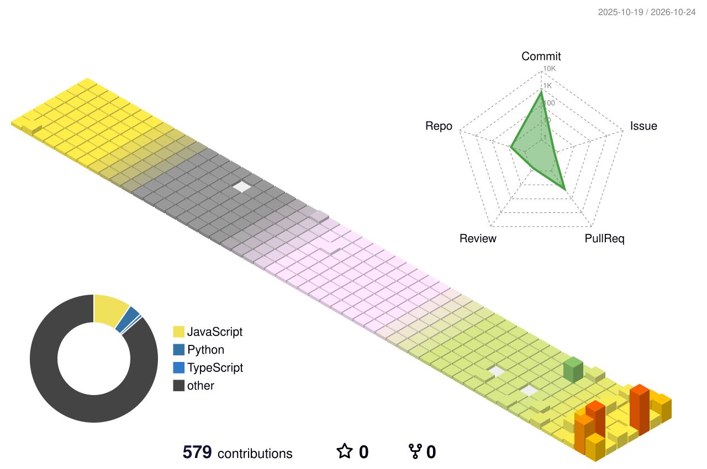

## 👋 About

SK hynix 업무 시스템을 **React 화면부터 Java / Spring API, Oracle 데이터 처리, Batch까지** 개발해 온 Full Stack Web Developer입니다.
화면 하나를 고치기보다 같은 문제가 반복될 곳을 찾아 **공통 구조로 해결**하는 것을 좋아합니다.

- 🏢 **플레이투게더** · Full Stack Web Developer (2024.07 ~ 현재)
- 🔧 지금은 **SK hynix ELM Portal** (반도체 장비 Life Cycle · Workflow · Dashboard) 개발 중
- 🌱 회사 밖에서는 RAG 검색, Django · Next.js · PostGIS로 사이드 프로젝트를 만들고 있습니다

## 🏢 Experience

| 기간 | 프로젝트 | 하이라이트 |
|---|---|---|
| 2025.04 ~ 현재 | **SK hynix ELM Portal** · 18명 | 검색·Form 공통 컴포넌트 **전체 화면** 적용 · Excel 5,000건 분할로 **최대 12만 건** 다운로드 · 일 **8만 건** 통계 Batch Timeout 해결 · Dashboard **27개 화면** IN 절 1,000건 제한 공통 SQL |
| 2025.01 ~ 2025.04 | 본사 솔루션 개발 | ELM Portal용 React 공통 컴포넌트 제작 |
| 2024.07 ~ 2025.01 | **SK hynix OPEX** · 25명 | 야간 매크로가 처리하는 **백만 건 단위** 비용 데이터의 수작업 Excel 정리를 헤더·PK 검증 업로드로 대체 · 사업비·원가 Dashboard |

## 🚀 Side Projects

### 🤖 [Tistory AI Assistant](https://github.com/juniel1299/blog) · 블로그 글 검색 RAG 챗봇 `운영 중`
내 블로그에 직접 만든 스킨을 입히고, 질문하면 관련 글을 찾아 주는 검색 챗봇을 붙였습니다.
- 키워드(FTS5) + 의미(bge-m3 임베딩) 검색을 **RRF**로 합친 하이브리드 검색
- 평가 세트 35개로 임계값 실측 조정 → **hit@3 100% · top1 93% · 무관한 질문 오탐 0%**
- 증분 색인 Cron + 서버리스 구성으로 **월 0원** 운영, GitHub Actions 자동 배포

### 🗺️ [CHII WORLD](https://github.com/juniel1299/ChiikawaGo) · 위치 기반 캐릭터 수집 서비스 `진행 중`
실무 스택(Java · Oracle) 밖에서 설계부터 테스트·운영까지 경험해 보는 프로젝트입니다.
- JWT Refresh Rotation · Blacklist를 행 잠금으로 처리해 **동시 갱신 요청 중 하나만 성공**하도록 보장
- PostGIS **GiST 인덱스** 기반 주변 Spot 반경 조회, 1만 건 샘플로 Index Scan 실행계획 검증
- 실제 PostGIS 대상 Backend 테스트 35개 + Playwright E2E, Docker Compose 개발 환경

## 💻 Tech Stack

**Backend & Database**

**Frontend**

**Side Projects**

**Tools**

## 📊 GitHub Stats

